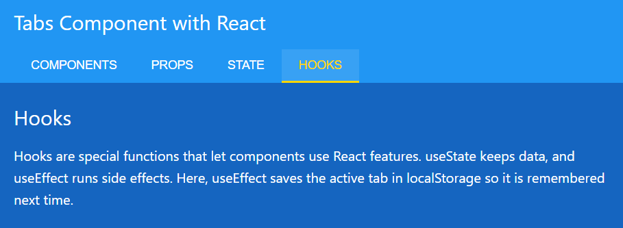

# React Tabs Component

A tabs component built with React (Vite) without any extra packages. Clicking a tab switches the content, and the app remembers the last active tab.



## Features

- Click on a tab to change the content
- Active tab is highlighted with an underline
- Remembers the last active tab using localStorage
- Reusable `Tab` and `TabContent` components
- Tab data is kept in a separate file, so adding a new tab only needs one new object

## Built with

- React
- Vite
- `useState` and `useEffect`
- localStorage
- CSS

## Project structure

```
src/
├── components/
│   ├── Tab.jsx
│   └── TabContent.jsx
├── App.jsx
├── App.css
├── data.js
└── main.jsx
```

## Run locally

```bash
git clone https://github.com/NazaninSalehfar/react-tabs-component.git
cd react-tabs-component
npm install
npm run dev
```

Then open `http://localhost:5173` in your browser.

## What I practiced

- Splitting a UI into components and passing data with props
- Managing the active tab with state
- Rendering a list with `map` and finding the active item with `find`
- Saving and restoring data with `useEffect` and localStorage
